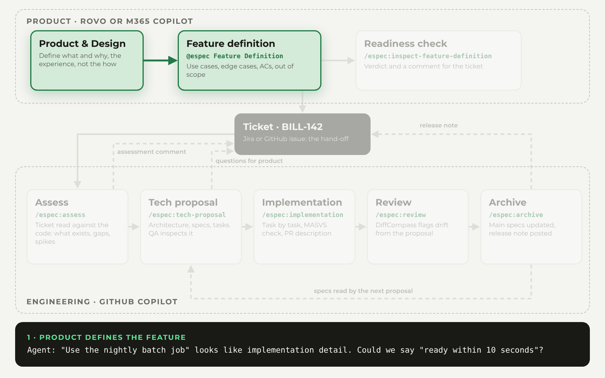
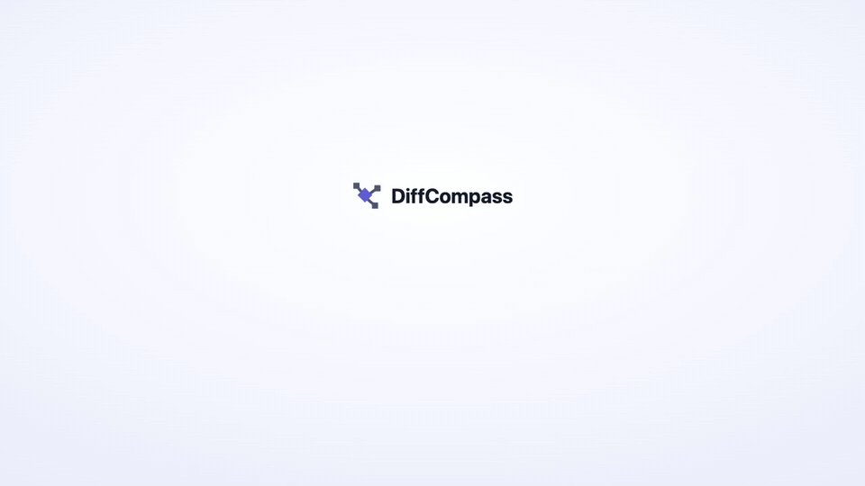
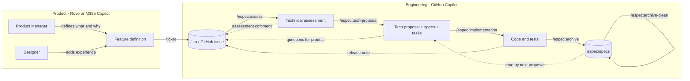

<p align="center">
  <picture>
    <source media="(prefers-color-scheme: dark)" srcset="assets/espec-dark.svg">
    
  </picture>
</p>

<p align="center">
  <strong>Spec-driven development for enterprises where different functions have different AI access.</strong>
</p>

<p align="center">
  <a href="./VERSION"></a>
  <a href="./LICENSE.md"></a>
  
  
  
  
</p>

```text
→ what and why before how
→ product owns the problem, engineering owns the solution
→ the ticket is the hand-off
→ one spec, many copilots
→ plain Markdown, living in the repo
```

<p align="center">
  
</p>

## Built for the enterprise

In a large organisation AI access is not uniform. Product Managers and Designers get Atlassian Rovo
or Microsoft 365 Copilot. Developers and QA get GitHub Copilot. Nobody has one assistant that spans
Confluence, Jira and the codebase, and nobody is going to.

**Enterprise Spec Driven Development**, `espec` for short, accepts that. Each function uses the AI it has, and the work moves
between them as a **ticket** written in a fixed format any assistant can read. Product writes the
*what* and the *why*. Engineering writes the *how*, builds it, and folds the result into a living set
of specs that the next feature starts from.

| Role | AI tool | What they produce |
|------|---------|-------------------|
| Product Manager | Rovo or M365 Copilot | Feature definition in a Jira or GitHub ticket |
| Designer | Rovo or M365 Copilot | UI design section of that ticket |
| Developer | GitHub Copilot | Tech proposal, specs, tasks, code |
| QA | GitHub Copilot | Test strategy input, verified scenarios |

## See it in action

```text
PM, in Rovo:    @espec Feature Definition  Define a new feature with me
Agent:          What problem are we solving, and for whom? What happens if we do nothing?
PM:             Finance can't get invoices out of the app. Use the nightly batch job for it.
Agent:          "Use the nightly batch job" looks like implementation detail. Could we say
                "the export must be ready within 10 seconds" instead? Or force it in?
PM:             Force it. Finance monitors that job already.
Agent:          Noted as ⚠️ FT-1 with your reason. Now, the second use case...
                ...
                Readiness check: all ✅. Status: Ready for tech proposal.
                Paste this into BILL-142.

Dev:              /espec-inspect-feature-definition BILL-142
Copilot:          Readiness 9/9 ✅. No how outside the forced notes. Every UC and EC has an AC.
                  Verdict: Ready for tech proposal (0 blocking, 2 advisory).
                  Advisory: can a running export be cancelled? What if access is revoked
                  mid-export?
                  Comment ready to post on BILL-142.

Dev:              /espec-assess BILL-142
Copilot:          Read 13 ACs and 7 constraints against main. Exists today: filters, entity
                  access, saved views, a job queue, an EU bucket, pre-signed URLs, an audit
                  log. Nothing writes CSV. FT-1 (nightly batch, 02:00 UTC) cannot meet the
                  10-second outcome: keep it and rephrase AC-1, or override it with exports
                  on the same Ops dashboard. 4 dependencies to confirm: platform, finance
                  ops, audit owner, release manager. 1 spike: 50,000-row stream in close week.
                  Outcome: Further discovery required (1 blocking, 4 advisory).
                  Comment ready to post on BILL-142.

Team:             Refinement. Product accepts overriding FT-1 with exports on the Ops
                  dashboard; the owners confirm the dependencies; the spike runs.
Dev:              /espec-assess BILL-142
Copilot:          Supersedes the earlier assessment: FT-1 decided by product, dependencies
                  confirmed, spike passed. Outcome: Ready for tech proposal.

Dev:              /espec-tech-proposal BILL-142
Copilot:          Imported BILL-142 → espec/changes/bill-142-invoice-csv-export/feature.md
                  ✓ tech-proposal.md   architecture, APIs, data model, 3 decisions
                  ✓ specs/invoice-export/spec.md   6 requirements, 11 scenarios
                  ✓ tasks.md           14 tasks in 5 groups
                  FT-1 overridden: nightly batch misses the 10 second outcome; async job
                  with status in the same ops dashboard. 1 question for product (not blocking).

QA:               /espec-inspect-tech-proposal bill-142-invoice-csv-export
Copilot:          Ticket and feature.md identical. 26 product ids traced to scenarios, tasks
                  and QA lines. FT-1 reviewed. 3 decisions with alternatives.
                  Verdict: Not yet (2 blocking). The exports list only shows 24 h, so the
                  Expired state can never appear. The Q4 code freeze has no home in Rollout.
Dev:              /espec-tech-proposal bill-142-invoice-csv-export
Copilot:          Updated: 48 h list window, Timing bullet under Rollout.
QA:               /espec-inspect-tech-proposal
Copilot:          Verdict: Approve (0 blocking, 5 advisory).

Dev:              /espec-implementation
Copilot:          Working on task 2.1: export job entity and migration ... ✓
                  ... 14/14 tasks complete.
                  ✓ pull-request.md   summary, proposal vs implementation, every AC → file and test
                  gh pr create --body-file espec/changes/bill-142-invoice-csv-export/pull-request.md

Dev:              /espec-archive
Copilot:          Synced invoice-export (new) and invoice-list (1 modified).
                  Archived to espec/changes/archive/2026-10-24-bill-142-invoice-csv-export/
                  Release note ready to post on BILL-142.
```

## The four phases

| # | Phase | Command | Who | Output |
|---|-------|---------|-----|--------|
| 1 | **AI Assisted Feature Definition** | `/espec:feature-definition`, then `/espec:assess` | Product, Design, then a developer | Ticket: why, what, use cases, edge cases, out of scope, acceptance criteria. An assessment comment: Ready for tech proposal or Further discovery required |
| 2 | **Tech Proposal** | `/espec:tech-proposal` | Developers, QA | `tech-proposal.md`, delta specs, `tasks.md` |
| 3 | **Implementation** | `/espec:implementation` | Developers, QA | Code and tests, tasks checked off, PR description |
| 4 | **Archive** | `/espec:archive` · `/espec:archive-clean` | Developers | Main specs updated; outdated specs purged or corrected |

**Phase 1** starts in product language only. It asks for every use case, every edge case and an
explicit out of scope. When a *how* slips in, it asks you to rephrase it as an outcome. If you insist,
it is recorded as a ⚠️ **forced technical note** that engineering must accept or override, with a
reason, in the tech proposal. It ends with a developer's technical assessment of the ticket against
the code, so product decides scope with the facts before anyone designs.

**Phase 2** is the deep dive: architecture, APIs, data model, technology decisions with alternatives,
a traceability table from every product id to a spec scenario and a task, a test strategy for QA, and
questions for product that go back on the ticket. Bugs take the same path with a lighter definition
and proposal.

**Phase 3** generates the code from the tech proposal and specs, one task at a time, and never
narrows scope silently. It ends with a pull request description a reviewer can read without opening
the code: what was built, where it differs from the proposal and why, and how it was verified. On a
mobile app it first runs a security validation against OWASP MASVS, fixes what the change introduced
and puts the rest on the pull request as an alert. The reviewer then runs `/espec:review`, which walks
the diff with [DiffCompass](https://github.com/Mindera/diffcompass): it reads the change folder and
flags code that drifts from the proposal.

**Phase 4** folds the change into the main specs. `archive-clean` goes further: it searches the specs
for anything the code no longer does, proposes keep, update or purge with evidence, and applies what
you confirm.

Three read-only commands sit between the phases. `/espec:inspect-feature-definition` checks a ticket
for missing information before engineering starts: hows outside the forced notes, use cases and edge
cases with no acceptance criterion, edge cases nobody thought of, criteria that cannot be tested.
`/espec:assess` reads the ticket against the code before the tech proposal: what exists today, with
file paths, which specs the feature touches, dependencies on other teams listed as unconfirmed with an
owner to ask, alternatives with their consequences for product, criteria that cannot be met as
written, and the spikes worth running. It ends with Ready for tech proposal or Further discovery
required. `/espec:inspect-tech-proposal` checks a proposal against its ticket before approval: every
product id traced to a scenario, a task and a QA line, every forced note answered, every constraint
with a home, no blocking question open. All three end with a verdict and a comment ready to paste on
the ticket.

In GitHub Copilot the commands are typed with a dash (`/espec-tech-proposal`), because prompt file
names cannot contain a colon. In Rovo and M365 Copilot, phase 1 is an agent you @-mention.

## Code review

Code review is integrated with [DiffCompass](https://github.com/Mindera/diffcompass), a local,
agent-led walkthrough of a pull request in the browser. The reviewer runs `/espec:review` and gets a
guided tour of the diff that already knows the change folder: the tech proposal, the delta specs, the
tasks and `pull-request.md`.

<p align="center">
  <a href="docs/guides/07-code-review.md"></a>
</p>

```text
Reviewer:         /espec-review 1234
Copilot:          Reviewing: pull request 1234. Change: bill-142-invoice-csv-export.
                  pull-request.md complete and matches the pull request body. 14/14 tasks checked.
                  Running: diffcompass pr 1234 --open
```

- **Primed with the change folder.** `espec init` adds `.diffcompass.json` at the repository root. It
  tells the tour agent to read the change folder before explaining code and to order the tour by
  **How to review** in `pull-request.md`: entry points, then the core, then tests.
- **Flags spec drift.** Findings include a `spec-drift` category: code that differs from the tech
  proposal or the delta specs without a row in **Proposal versus implementation**, behaviour no
  acceptance criterion or scenario describes, a named test missing from the diff, and any edit to
  `espec/specs/` outside an archive.
- **Feedback lands on the pull request.** Ask the tour questions as you go and leave line comments.
  Approval still happens in the pull request.
- **Optional.** `review.tool: diffcompass` in `espec/config.yaml` turns it on. Set `none` to review
  by hand from `pull-request.md`.

See [Step 7: Code review](docs/guides/07-code-review.md) for the two-pass review and what to decide on
each finding.

## Security validation

Mobile apps get a security validation before the pull request description is written. The
implementation step runs
[AI Mobile Security Assessment](https://github.com/Mindera/AI-Mobile-Security-Assessment), a static,
evidence-backed assessment of Android, iOS and Kotlin Multiplatform code against OWASP MASVS, where
every finding cites a file and line.

```text
Copilot:          Security validation: android detected. Running msa assess on the repository.
                  2 findings in files this change touches: D01 SessionStore.kt:10, D06 HttpClient.kt:36.
                  Added S.1 and S.2 to tasks.md. Fixing S.1...
                  Second run: 0 findings in this change, 3 pre-existing.
                  ⚠️ Security findings: fix before merge. Report saved as security-report.md.
```

- **Optional, by access.** The tool's repository is private. The step runs only when the signed-in
  GitHub user can read it; otherwise the pull request says "Security validation skipped" and nothing
  is attached. Set `security.tool: none` in `espec/config.yaml` to turn it off.
- **Fixes what the change caused.** A finding in a file the diff touches becomes a task in a
  `## Security` group of `tasks.md`, is fixed, and is checked when a second run no longer reports it.
  Pre-existing findings are reported, not fixed in the change.
- **Alert on the pull request.** Findings left: `pull-request.md` carries "⚠️ Security findings: fix
  before merge", one row per finding and the report, saved as `security-report.md` in the change
  folder. No findings: one line, "Security validation passed". The reviewer treats a finding in a
  touched file as a change request, and the DiffCompass tour flags it.

## How it flows



## Quick start

### Engineering

```bash
git clone https://github.com/Mindera/Enterprise-Spec-Driven-Development.git ~/espec
```

```bash
~/espec/bin/espec init /path/to/your/repo
```

Then fill in `espec/project.md` and `espec/config.yaml`, commit, and restart your IDE so GitHub
Copilot picks up the prompt files. Type `/espec-` in Copilot Chat to see the commands.
Windows users run `bin\espec.ps1` with the same arguments.

Your repo also gets its own copy of the validator in `espec/bin` and a GitHub Actions workflow that
runs it on every pull request, so format rules are checked without any dependency
on this toolkit. Then name your tech proposal approvers in CODEOWNERS
([engineering setup, step 5](docs/guides/setup-engineering.md#step-5-protect-approval-and-the-main-specs)).
To pin a version, check out its tag (`git -C ~/espec checkout v1.0.16`) before `init` or `update`.

### Product and design

Open [`product-ai/`](product-ai/), pick `rovo/` or `m365-copilot/`, and create the two agents from
the files there. Each file holds the name, description, starters and the instructions to paste.
Add the ticket template from `product-ai/ticket-templates/` to Jira or GitHub. Done.

<details>
<summary><strong>What do the specs look like?</strong></summary>

Plain Markdown. Requirements with concrete scenarios, no syntax to learn.

```markdown
## ADDED Requirements

### Requirement: Export current filter
The system SHALL export the invoices matching the active list filters as a CSV file.

#### Scenario: Successful export
- **GIVEN** a finance user with 1,200 invoices matching the current filter
- **WHEN** they choose Export
- **THEN** a CSV with 1,200 rows is available for download within 10 seconds
- **AND** the file name includes the filter summary and the export date
```

At archive time the delta is merged into `espec/specs/invoice-export/spec.md`, which the next tech
proposal reads. Browse the [worked example](examples/) for a full change, phase by phase.

</details>

## What gets created

```text
your-repo/
├── .diffcompass.json                      # Code review tour settings: read the change folder first
├── .markdownlint-cli2.yaml                # Optional markdownlint settings that skip the managed files
├── .github/
│   ├── copilot-instructions.md            # Repo-wide rules for Copilot
│   ├── prompts/espec-*.prompt.md          # The five commands, the assessment, two inspections, review, design context
│   ├── instructions/espec.instructions.md # Format rules applied to espec/**
│   ├── workflows/espec-validate.yml       # CI: validates changes and specs on every pull request
│   ├── ISSUE_TEMPLATE/feature-definition.md
│   └── PULL_REQUEST_TEMPLATE/espec-spec-change.md # For tech proposal and archive pull requests
└── espec/
    ├── AGENTS.md                          # Conventions for humans and AI
    ├── LICENSE.md, .toolkit-version       # The toolkit's licence and the version you run
    ├── project.md                         # Your stack, teams, traps
    ├── config.yaml                        # Ticket system, review and security tools, rules, archive settings
    ├── specs/<capability>/spec.md         # The system as it is today
    ├── changes/<change-name>/             # feature.md · tech-proposal.md · specs/ · tasks.md · pull-request.md
    │   ├── security-report.md             # Mobile apps: the security findings, only when there are some
    │   └── inspections/                   # Saved inspection reports, only on request
    ├── changes/archive/                   # Finished changes and clean-up reports
    ├── templates/                         # Blank files the commands start from
    └── bin/                               # espec validate · new · list · stamp · repos · version, no toolkit needed
```

## Docs

- [Step-by-step guides](docs/guides/README.md) · setup for engineering and product, then one walkthrough per step
- [Workflow](docs/workflow.md) · the end-to-end flow and hand-offs
- [Commands](docs/commands.md) · every command, input and output
- [Conventions](docs/conventions.md) · formats, delta operations, archive rules
- [Roles and tools](docs/roles-and-tools.md) · setup per role
- [Spec hub](docs/guides/setup-spec-hub.md) · specs in one repository, code in several, when they cannot live together
- [FAQ](docs/faq.md)
- [Worked example](examples/) · an invoice export, from ticket to archived spec
- [Changelog](CHANGELOG.md) · what changed in each version, and what to do when you update

## Support and contributing

Questions, bugs and ideas go to [GitHub Issues](https://github.com/Mindera/Enterprise-Spec-Driven-Development/issues).
Pull requests are welcome. Keep the README simple and the prompts shorter than the documents they
produce.

The current version is **v1.0.16**, kept in [`VERSION`](VERSION). Every change bumps the last number
(`vX.Y.Z` → `vX.Y.Z+1`) and adds an entry to the [changelog](CHANGELOG.md); every version merged to
`main` is tagged and released. See [`AGENTS.md`](AGENTS.md) for the rules every contributor and every
AI assistant follows.

## License

[Sustainable Use License 1.0](LICENSE.md). Free to use and modify for your own internal business,
non-commercial or personal purposes, and to share free of charge for non-commercial purposes. You may
not sell it or offer it as a paid service, and modified copies must say they were modified. `init`
copies the licence into every repository it sets up, at `espec/LICENSE.md`.

---

<sub>GitHub Copilot is a trademark of GitHub, Inc. and Microsoft Corporation. Microsoft 365 Copilot is a trademark of Microsoft Corporation. Rovo is a trademark of Atlassian Pty Ltd. Enterprise Spec Driven Development is an independent project and is not affiliated with, sponsored by, or endorsed by GitHub, Microsoft or Atlassian.</sub>
