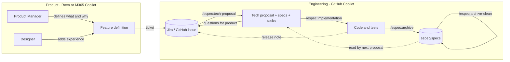

<p align="center">
  <picture>
    <source media="(prefers-color-scheme: dark)" srcset="assets/espec-dark.svg">
    
  </picture>
</p>

<p align="center">
  <strong>Spec-driven development for enterprises where every function has a different AI.</strong>
</p>

<p align="center">
  <a href="./LICENSE"></a>
  
  
  
  
</p>

```text
→ what and why before how
→ product owns the problem, engineering owns the solution
→ the ticket is the hand-off
→ one spec, many copilots
→ plain Markdown, living in the repo
```

## Built for the enterprise

In a large organisation AI access is not uniform. Product Managers and Designers get Atlassian Rovo
or Microsoft 365 Copilot. Developers and QA get GitHub Copilot. Nobody has one assistant that spans
Confluence, Jira and the codebase, and nobody is going to.

**Enterprise Spec Driven Development**, `espec` for short, accepts that. Each function uses the AI it has, and the work moves
between them as a **ticket** written in a fixed format any assistant can read. Product writes the
*what* and the *why*. Engineering writes the *how*, builds it, and folds the result into a living set
of specs that the next feature starts from.

| Role | AI tool | What they produce |
|------|---------|-------------------|
| Product Manager | Rovo or M365 Copilot | Feature definition in a Jira or GitHub ticket |
| Designer | Rovo or M365 Copilot | Experience and design section of that ticket |
| Developer | GitHub Copilot | Tech proposal, specs, tasks, code |
| QA | GitHub Copilot | Test strategy input, verified scenarios |

## See it in action

```text
PM, in Rovo:    @espec Feature Definition  Define a new feature with me
Agent:          What problem are we solving, and for whom? What happens if we do nothing?
PM:             Finance can't get invoices out of the app. Use the nightly batch job for it.
Agent:          "Use the nightly batch job" looks like implementation detail. Could we say
                "the export must be ready within 10 seconds" instead? Or force it in?
PM:             Force it. Finance monitors that job already.
Agent:          Noted as ⚠️ FT-1 with your reason. Now, the second use case...
                ...
                Readiness check: all ✅. Status: Ready for tech proposal.
                Paste this into BILL-142.

Dev, in VS Code:  /espec-tech-proposal BILL-142
Copilot:          Imported BILL-142 → espec/changes/bill-142-invoice-csv-export/feature.md
                  ✓ tech-proposal.md   architecture, APIs, data model, 3 decisions
                  ✓ specs/invoice-export/spec.md   6 requirements, 11 scenarios
                  ✓ tasks.md           14 tasks in 5 groups
                  FT-1 overridden: nightly batch misses the 10 second outcome; async job
                  with status in the same ops dashboard. 1 question for product (not blocking).

Dev:              /espec-implementation
Copilot:          Working on task 2.1: export job entity and migration ... ✓
                  ... 14/14 tasks complete. Run /espec-archive when reviewed.

Dev:              /espec-archive
Copilot:          Synced invoice-export (new) and invoice-list (1 modified).
                  Archived to espec/changes/archive/2026-10-24-bill-142-invoice-csv-export/
                  Release note ready to post on BILL-142.
```

## The four phases

| # | Phase | Command | Who | Output |
|---|-------|---------|-----|--------|
| 1 | **AI Assisted Feature Definition** | `/espec:feature-definition` | Product, Design | Ticket: why, what, use cases, edge cases, out of scope, acceptance criteria |
| 2 | **Tech Proposal** | `/espec:tech-proposal` | Developers, QA | `tech-proposal.md`, delta specs, `tasks.md` |
| 3 | **Implementation** | `/espec:implementation` | Developers, QA | Code and tests, tasks checked off as verified |
| 4 | **Archive** | `/espec:archive` · `/espec:archive-clean` | Developers | Main specs updated; outdated specs purged or corrected |

**Phase 1** only knows product. It asks for every use case, every edge case and an explicit out of
scope. When a *how* slips in, it asks you to rephrase it as an outcome. If you insist, it is recorded
as a ⚠️ **forced technical note** that engineering must accept or override, with a reason, in the
tech proposal.

**Phase 2** is the deep dive: architecture, APIs, data model, technology decisions with alternatives,
a traceability table from every product id to a spec scenario and a task, a test strategy for QA, and
questions for product that go back on the ticket.

**Phase 3** generates the code from the tech proposal and specs, one task at a time, and never
narrows scope silently.

**Phase 4** folds the change into the main specs. `archive-clean` goes further: it searches the specs
for anything the code no longer does, proposes keep, update or purge with evidence, and applies what
you confirm.

In GitHub Copilot the commands are typed with a dash (`/espec-tech-proposal`), because prompt file
names cannot contain a colon. In Rovo and M365 Copilot, phase 1 is an agent you @-mention.

## How it flows



## Quick start

### Engineering

```bash
git clone https://github.com/Mindera/Enterprise-Spec-Driven-Development.git ~/espec
```

```bash
~/espec/bin/espec init /path/to/your/repo
```

Then fill in `espec/project.md` and `espec/config.yaml`, commit, and restart your IDE so GitHub
Copilot picks up the prompt files. Type `/espec-` in Copilot Chat to see the five commands.
Windows users run `bin\espec.ps1` with the same arguments.

Your repo also gets its own copy of the validator in `espec/bin` and a GitHub Actions workflow that
runs it on every pull request touching `espec/`, so format rules are checked without any dependency
on this toolkit.

### Product and design

Open [`product-ai/`](product-ai/), pick `rovo/` or `m365-copilot/`, and create the two agents from
the files there. Each file holds the name, description, starters and the instructions to paste.
Add the ticket template from `product-ai/ticket-templates/` to Jira or GitHub. Done.

<details>
<summary><strong>What do the specs look like?</strong></summary>

Plain Markdown. Requirements with concrete scenarios, no syntax to learn.

```markdown
## ADDED Requirements

### Requirement: Export current filter
The system SHALL export the invoices matching the active list filters as a CSV file.

#### Scenario: Successful export
- **GIVEN** a finance user with 1,200 invoices matching the current filter
- **WHEN** they choose Export
- **THEN** a CSV with 1,200 rows is available for download within 10 seconds
- **AND** the file name includes the filter summary and the export date
```

At archive time the delta is merged into `espec/specs/invoice-export/spec.md`, which the next tech
proposal reads. Browse the [worked example](examples/) for a full change, phase by phase.

</details>

## What gets created

```text
your-repo/
├── .github/
│   ├── copilot-instructions.md            # Repo-wide rules for Copilot
│   ├── prompts/espec-*.prompt.md          # The five commands
│   ├── instructions/espec.instructions.md # Format rules applied to espec/**
│   ├── workflows/espec-validate.yml       # CI: validates changes and specs on pull requests
│   └── ISSUE_TEMPLATE/feature-definition.md
└── espec/
    ├── AGENTS.md                          # Conventions for humans and AI
    ├── project.md                         # Your stack, teams, traps
    ├── config.yaml                        # Ticket system, rules, archive settings
    ├── specs/<capability>/spec.md         # The system as it is today
    ├── changes/<change-name>/             # feature.md · tech-proposal.md · specs/ · tasks.md
    ├── changes/archive/                   # Finished changes and clean-up reports
    ├── templates/                         # Blank files the commands start from
    └── bin/                               # espec validate · new · list, no toolkit needed
```

## Docs

- [Workflow](docs/workflow.md) · the end-to-end flow and hand-offs
- [Commands](docs/commands.md) · every command, input and output
- [Conventions](docs/conventions.md) · formats, delta operations, archive rules
- [Roles and tools](docs/roles-and-tools.md) · setup per role
- [FAQ](docs/faq.md)
- [Worked example](examples/) · an invoice export, from ticket to archived spec

## Contributing

Issues and pull requests are welcome. Keep the README simple and the prompts shorter than the
documents they produce.

## License

[PolyForm Noncommercial 1.0.0](LICENSE). Free to use, copy, modify and share for noncommercial
purposes. Contact Mindera for commercial use.

---

<sub>GitHub Copilot is a trademark of GitHub, Inc. and Microsoft Corporation. Microsoft 365 Copilot is a trademark of Microsoft Corporation. Rovo is a trademark of Atlassian Pty Ltd. Enterprise Spec Driven Development is an independent project and is not affiliated with, sponsored by, or endorsed by GitHub, Microsoft or Atlassian.</sub>
