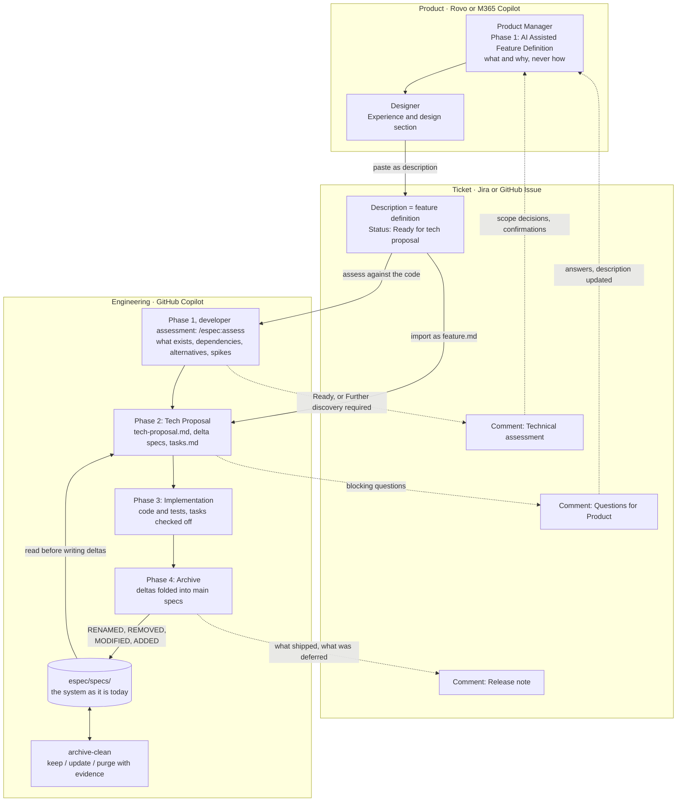

# Workflow

espec takes a feature from an idea to a living specification in four phases. Product owns phase 1.
Engineering owns phases 2 to 4. The two sides use different AI tools, so the hand-off between them
is a ticket written in a fixed format that any assistant can read and any human can review.

The formats and rules live in [template/espec/AGENTS.md](../template/espec/AGENTS.md). This page
explains how the phases connect across roles and tools. For the commands see
[commands.md](commands.md). For the formats see [conventions.md](conventions.md). For a walkthrough of
each step, with setup and common problems, see [guides/README.md](guides/README.md).

## The flow

Three things to notice:

- The ticket description and `feature.md` are the same text. Product edits the ticket. Engineering
  imports it. When they differ, the AI shows the diff and asks which one wins.
- Engineering never edits `espec/specs/` by hand. Main specs change only when a change is archived,
  or when archive-clean runs and the user confirms its verdicts.
- The next tech proposal starts by reading the main specs. That loop is what keeps the specs true.

## Phase 1: AI Assisted Feature Definition

Product owns this phase. It has two steps: product writes the feature definition, then a developer
assesses it against the repository before the tech proposal starts.

### Product writes the feature definition

| | |
|---|---|
| Command | `/espec:feature-definition` |
| Who | The Product Manager writes. The Designer fills the Experience and design section. QA reviews edge cases and acceptance criteria. |
| Tool | Rovo or M365 Copilot, with the agents in [product-ai/](../product-ai/README.md). GitHub Copilot in-repo when a developer starts a feature: `/espec-feature-definition`. |
| Inputs | The idea, the research, the available designs, the business why, known uncertainties. |
| Outputs | The ticket description in the feature definition format, with the readiness checklist all ✅ and the status line set to Ready for tech proposal. In-repo, also `espec/changes/<change-name>/feature.md`. |
| Exit criteria | **Ready for tech proposal** on the ticket: Why, What, at least one UC, edge cases, out of scope and acceptance criteria are present, every UC and EC maps to an AC, open questions are answered or accepted as deferred, and no how sits outside the forced notes. `/espec:inspect-feature-definition` returns Ready for tech proposal. |
| Hand-off | The ticket. Product hands it to engineering when it is sufficiently specified for technical assessment, or when they cannot progress further without engineering input, for example because the desired behaviour depends on capabilities or constraints they cannot assess. |

This hand-off means **ready for technical investigation**, not necessarily ready for estimation or
implementation. The Product Owner is not expected to establish technical feasibility or identify every
dependency beforehand. That is what the assessment is for.

### Developer assessment: `/espec:assess`

| | |
|---|---|
| Command | `/espec:assess` |
| Who | A developer leads the investigation, involving Product, Design, QA and other teams as needed. |
| Tool | GitHub Copilot, with access to the repository: `/espec-assess <ticket key, URL or change name>`. |
| Inputs | The ticket, available designs and research, known questions, the code and its tests, the main specs in `espec/specs/`, API contracts, `espec/project.md` and `espec/config.yaml`. |
| Activity | Investigate feasibility with Copilot: what the code already does for each acceptance criterion and constraint, with file paths; which capabilities in `espec/specs/` the feature touches; dependencies outside the repository, listed as unconfirmed with an owner to ask; alternatives with their consequences for product; criteria that cannot be met as written, with an outcome rephrasing; spikes where reading the code cannot answer a question. Seek clarification or confirmation from the appropriate people. |
| Outputs | The Technical assessment report, printed in the chat and pasted as a developer-authored comment on the ticket: findings, evidence, alternatives and trade-offs, questions, dependencies, and links to any spikes or related work. On request, saved to `espec/changes/<change-name>/inspections/YYYY-MM-DD-assess.md`. The PO updates the ticket description after scope decisions are agreed. |
| Completion outcome | Either **Ready for tech proposal**, or **Further discovery required**, with the outstanding questions, dependencies or spikes recorded and their next actions identified. |
| Hand-off | Findings return to Product/Design for clarification or scope decisions, to external teams for confirmation, or to a spike for further investigation. Once sufficiently resolved, the ticket proceeds to the tech proposal phase. |

The developer and Copilot investigate together rather than merely checking whether the ticket contains
every required heading (that check is `/espec:inspect-feature-definition`). They distinguish what the
system already supports from what requires additional requests, service changes or other work. Where
meaningful alternatives exist, they explain the consequences so Product can make informed scope
decisions.

Code evidence does not, by itself, confirm another team's capability or delivery commitment. Those
dependencies require confirmation from the relevant owners.

The assessment comment preserves the investigation and its rationale. **The PO-maintained ticket
description remains the agreed delivery scope**; alternatives and recommendations do not become
requirements unless explicitly accepted.

**Readiness rule:** proceed to the tech proposal when the agreed scope and available technical
evidence are sufficient to develop a credible proposal. Material feasibility blockers must be resolved
or removed from scope through an explicit decision; remaining non-blocking assumptions must stay
visible. After further discovery, the developer re-runs `/espec:assess`; the new comment supersedes
the old one and says which blocking findings were resolved and how.

## Phase 2: Tech Proposal

| | |
|---|---|
| Command | `/espec:tech-proposal` |
| Who | Developer writes. QA contributes the test strategy. Engineering Manager or Architect reviews. |
| Tool | GitHub Copilot: `/espec-tech-proposal <ticket key, URL or change name>`. |
| Inputs | The ticket (fetched through an Atlassian or GitHub MCP server, or pasted), `espec/project.md`, `espec/config.yaml`, the main specs in `espec/specs/`, and the code. |
| Outputs | `espec/changes/<change-name>/` holding `feature.md` (imported), `tech-proposal.md`, delta specs under `specs/<capability>/spec.md`, `tasks.md`, and `.espec.yaml` with `status: proposed`. In the chat, a coverage report: how much of the feature definition the proposal covers, id by id. |
| Exit criteria | **Approved**: the reviewer sets the status line in `tech-proposal.md` to Approved. Every `FT-n` is marked Accepted or Overridden. The traceability table covers every UC, EC and AC. No blocking Question for Product is open. Every MODIFIED and REMOVED requirement carries a base stamp (`espec stamp`). `/espec:inspect-tech-proposal` returns Approve. |
| Hand-off | **Questions for Product** are pasted as a ticket comment. Product answers in the ticket and updates the description. Engineering re-imports and revises. |

The proposal is reviewed where the project says, usually a pull request that adds the change
folder. Record the place in `espec/project.md` under Ticketing, and name the approvers in CODEOWNERS
so the Approved line cannot reach `main` without them. Nothing outside
`espec/changes/<change-name>/` changes in this phase.

Approval covers the proposal as approved. A later change to a decision, the scope or observable
behaviour, in this phase or the next, sets the status line back to **In review** and the reviewer
approves again.

A bug runs through the same phases with a lighter definition and proposal: see
[Bug fixes](../template/espec/AGENTS.md#bug-fixes).

## Phase 3: Implementation

| | |
|---|---|
| Command | `/espec:implementation` |
| Who | Developer implements. QA runs the `## QA verification` group. |
| Tool | GitHub Copilot: `/espec-implementation <change-name>`. |
| Inputs | The approved change folder, re-read from disk every time, in a new chat or session so the proposal conversation does not steer the code. |
| Outputs | Code and tests. `tasks.md` with a task checked off only after its verification passed. `pull-request.md`: the pull request description, readable without the code, with a proposal-versus-implementation table. `.espec.yaml` moves to `in-progress` after the first check and `implemented` after the last. In the chat, a coverage report: how much of the proposal and the feature definition the code delivers, criterion by criterion. |
| Exit criteria | **All tasks complete**: every checkbox in `tasks.md` is `[x]`, including the QA verification group. |
| Hand-off | The pull request, whose description is `pull-request.md`. It links to the ticket, and its Release note section becomes the ticket comment at archive. |
| Code review | The reviewer reads `pull-request.md`, then runs `/espec:review <number>` to walk the diff with [DiffCompass](https://github.com/Mindera/diffcompass). `.diffcompass.json` points its agent at the change folder, so the tour follows **How to review** and flags drift from the tech proposal and the delta specs. |

The AI pauses when a task is unclear, needs work the specs do not describe, or would reduce specified
behaviour. It never narrows scope silently. A design problem found here becomes a tech proposal
update, not a workaround: the proposal goes back to In review and implementation waits for the new
approval.

## Phase 4: Archive

| | |
|---|---|
| Commands | `/espec:archive` and `/espec:archive-clean` |
| Who | Developer. |
| Tool | GitHub Copilot: `/espec-archive <change-name>` and `/espec-archive-clean [capability]`. |
| Inputs | An implemented change. For clean: every main spec, the archive, the code and the tests. |
| Outputs | Archive: main specs updated from the deltas, the change folder moved to `espec/changes/archive/YYYY-MM-DD-<change-name>/`, a release note. Clean: `cleanup.md` with keep / update / purge verdicts and evidence, applied only on confirmation. |
| Exit criteria | **Archived**: `.espec.yaml` says `archived`, no delta headings remain in the main specs, every requirement still has a scenario. |
| Hand-off | The release note is pasted as a ticket comment: what shipped, which specs changed, what was deferred. The ticket is closed. |

Archive runs after the implementation pull request is merged, either as its own short pull request
or as the last commit of the implementation pull request (see
[the guides](guides/README.md#pull-requests-along-the-way)). Archive stops on any conflict before
moving anything, including a base stamp that shows another change edited the same requirement first.
Archive-clean never deletes without evidence and a confirmed verdict. In CI, a pull request that
changes `espec/specs/` without archiving a change fails. See
[conventions.md](conventions.md#archive-merge-order-and-conflicts).

## Where things live

| Artifact | Ticket | Repository |
|---|---|---|
| Feature definition | Description. Product edits here. | `espec/changes/<change-name>/feature.md`, an identical copy |
| Design notes | **Experience and design** section of the description | Same section of `feature.md` |
| Forced technical notes | `## Forced technical notes` in the description | Same section of `feature.md`, reviewed in `tech-proposal.md` |
| Technical assessment | Comment from engineering, with the outcome | Printed by `/espec:assess`. On request, `espec/changes/<change-name>/inspections/YYYY-MM-DD-assess.md` |
| Questions for Product | Comment from engineering | `## Questions for Product` in `tech-proposal.md` |
| Answers from product | Comment, then the description is updated | `feature.md` updated to match |
| Tech proposal | Optional link to the pull request | `tech-proposal.md` |
| Delta specs | Not in the ticket | `espec/changes/<change-name>/specs/<capability>/spec.md` |
| Tasks and progress | Not in the ticket | `tasks.md`, and `status` in `.espec.yaml` |
| Pull request description | Link to the pull request | `pull-request.md`, also used as the pull request body |
| Status | The team's ticket workflow (To do, Ready, In progress, Done) | `status` in `.espec.yaml` |
| Release note | Comment from engineering | Printed by archive. The archived folder is the record. |
| Main specs | Not in the ticket | `espec/specs/<capability>/spec.md` |
| Clean-up audit trail | Not in the ticket | `espec/changes/archive/YYYY-MM-DD-archive-clean/cleanup.md` |

Rule of thumb: product reads and writes the ticket, engineering reads and writes the repo, and the
feature definition is the one text that lives in both.

## When the ticket system is GitHub Issues

The phases do not change. The hand-off does.

1. Set `tickets.system: github` in `espec/config.yaml`, with the repo and the label.
2. The issue template at
   [template/.github/ISSUE_TEMPLATE/feature-definition.md](../template/.github/ISSUE_TEMPLATE/feature-definition.md)
   opens a new issue with the feature definition skeleton and the `feature-definition` label
   already applied. Product writes the definition with M365 Copilot or Rovo and pastes the result
   into the body.
3. The body starts with `<!-- espec:feature-definition v1 -->`.
   [template/.github/copilot-instructions.md](../template/.github/copilot-instructions.md) tells
   GitHub Copilot that an issue with this marker is a feature definition and must not be
   implemented directly.
4. A developer runs `/espec-assess <issue URL>` in Copilot Chat and posts the assessment as an
   issue comment. Product decides on what it raises; the issue body stays the agreed scope.
5. When the outcome is Ready for tech proposal, a developer runs `/espec-tech-proposal <issue URL>`
   in Copilot Chat, or the issue is assigned to the Copilot coding agent. Either way the first output
   is a pull request that adds `espec/changes/<change-name>/` with the tech proposal, delta specs and
   tasks. Nothing else changes in that PR.
6. Questions for Product go in an issue comment. The reviewer approves the tech proposal PR.
7. Implementation follows as a second pull request: a developer runs `/espec-implementation`, or
   the coding agent is assigned again now that an approved change exists in the repo.
8. Archive runs after the merge. The release note is the closing comment on the issue.

The change name uses the issue number as its key, for example `gh-142-invoice-csv-export`, and
`.espec.yaml` stores the issue URL under `ticket`.
