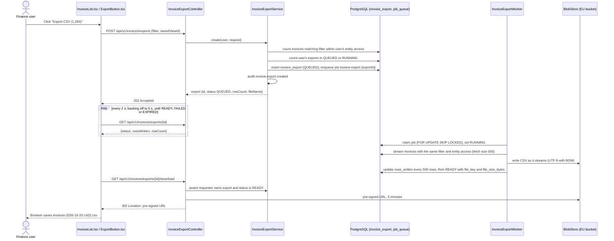

# Tech Proposal: Export invoices as CSV

**Feature:** [feature.md](feature.md) · **Ticket:** BILL-142 · **Author:** Priya Raghavan · **Status:** Approved

## Context

Observed in the repository on 2026-10-21 (main at `c41f9e2`).

- **Invoice list API.** `src/main/java/com/ledgerly/invoices/InvoiceController.java` serves
  `GET /api/v1/invoices`, bound to `InvoiceFilter` (`src/main/java/com/ledgerly/invoices/InvoiceFilter.java`, a
  record with `status`, `customerId`, `legalEntityId`, `issuedFrom`, `issuedTo`, `currency`, `search`). It pages
  50 rows at a time through `InvoiceRepository.findAll(Specification, Pageable)`; the predicates are built in
  `InvoiceSpecifications.java`. The frontend sends the same filter as query parameters, so a filter is already a
  serialisable value we can pass around.
- **Entity visibility.** `src/main/java/com/ledgerly/security/EntityAccessFilter.java` adds a
  `legal_entity_id IN (...)` predicate for every invoice query based on `UserEntityAccess`. Roles live in
  `src/main/java/com/ledgerly/security/Role.java` (`FINANCE_MANAGER`, `FINANCE_CONTROLLER`, `ACCOUNTANT_READONLY`,
  `SALES`). Viewing invoices is the permission `invoices:read`, held by the three finance roles and not by
  `SALES`.
- **Saved views.** `src/main/java/com/ledgerly/views/SavedViewService.java` stores an `InvoiceFilter` as JSON in
  `saved_view.filter_json` with a `name` and an `owner_user_id`. Views are per user. The frontend applies a view
  by writing its filter into the URL (`web/src/features/invoices/SavedViewPicker.tsx`).
- **Background jobs.** `src/main/java/com/ledgerly/jobs/JobQueue.java` and `JobWorker.java` implement a
  PostgreSQL-backed queue (`job_queue` table, `FOR UPDATE SKIP LOCKED`, two worker threads per node) used today
  for payment reminders and statement generation. Job types register a handler and a retry policy in
  `JobTypeRegistry.java`. The workers publish `ledgerly_job_duration_seconds`, `ledgerly_job_failures_total` and
  `ledgerly_job_queue_depth` tagged by `type`.
- **Nightly batch.** `src/main/java/com/ledgerly/batch/NightlyStatementJob.java` is a Spring Batch job scheduled
  at 02:00 UTC. It is what FT-1 refers to. Its metrics (`ledgerly_batch_*`) and the job-queue metrics above are
  both shown on the Grafana dashboard "Ledgerly Ops" (`ops/grafana/ledgerly-ops.json`), which is what finance
  operations watch.
- **File storage.** `src/main/java/com/ledgerly/storage/BlobStore.java` wraps S3-compatible storage. Production
  configuration (`src/main/resources/application-prod.yaml`, `ledgerly.storage.region: eu-central-1`) keeps the
  bucket in the EU. `PdfDownloadController.java` already serves invoice PDFs through 15-minute pre-signed URLs.
- **Audit log.** `src/main/java/com/ledgerly/audit/AuditLog.java` records `(actor, action, subject, payload)`;
  retention is handled centrally.
- **Feature flags.** Backend `FeatureFlagService.java` reads `ledgerly.flags.*`; the frontend reads
  `GET /api/v1/flags` through `web/src/lib/flags.ts`.
- **Frontend.** `web/src/features/invoices/InvoiceList.tsx` renders the toolbar and table. Filters are URL state in
  `useInvoiceFilters.ts`. The list already knows the total count (`total` from the paged response). Messages use
  `web/src/components/Toast.tsx` (persistent toasts with actions, live region built in). Polling of job status
  already exists for reminders in `web/src/features/reminders/useJobStatus.ts`.
- **Tests.** Backend: JUnit 5 with Testcontainers PostgreSQL (`src/test/java/...`, `*IT` for integration).
  Frontend: Vitest and Testing Library (`web/src/**/*.test.tsx`), Playwright in `web/e2e/`. Contract tests check
  `src/main/resources/openapi/ledgerly-v1.yaml` against the controllers (`OpenApiContractTest`).
- **CSV today.** `BankStatementParser.java` already uses Apache Commons CSV 1.11 for imports. Nothing writes CSV.

Assumption, not observed: the production database can sustain one streaming read of 50,000 invoices alongside
close-week traffic. The load test in task 5.3 verifies this before rollout.

## Approach

An export is an asynchronous job. `POST /api/v1/invoices/exports` validates the request (permission, row limit,
concurrency), writes an `invoice_export` row, enqueues an `invoice-export` job on the existing job queue, writes
an audit entry and returns `202` at once. The worker re-runs the same `InvoiceSpecifications` filter with the
requester's entity access, streams the rows into a CSV written straight to the EU bucket, and marks the export
`READY`. The frontend polls the status endpoint; when the export is ready and the user is still on the list, the
download starts automatically. Exports that outlive the page are listed by `GET /api/v1/invoices/exports` and
shown in an Exports indicator in the top bar. Downloads go through `GET .../download`, which checks ownership
and redirects to a five-minute pre-signed URL. An hourly clean-up removes files older than 24 hours.

Small and large exports follow the same path. "Within 10 seconds" for typical exports comes from the queue being
idle most of the time and from streaming (no buffering of the whole file), which the load test confirms.

## Architecture

| Component | Location | Responsibility |
|-----------|----------|----------------|
| `ExportButton.tsx` | `web/src/features/invoices/` | Toolbar action with count, flag-gated, moves into More actions below 900 px |
| `useInvoiceExport.ts` | `web/src/features/invoices/` | Create export, poll status (2 s, backing off to 5 s), trigger download, map errors to messages |
| `ExportsIndicator.tsx` | `web/src/components/` | Top-bar list of the user's exports of the last 48 h with progress, Download and Expired |
| `InvoiceExportController` | `src/main/java/com/ledgerly/invoices/export/` | The three endpoints plus the list endpoint |
| `InvoiceExportService` | same | Validation, creation, status, download URL, saved-view resolution, audit |
| `InvoiceExportWorker` | same | `invoice-export` job handler: stream, write, mark READY or FAILED |
| `InvoiceCsvWriter` | same | Column mapping, quoting, formula guard, number and date formatting |
| `InvoiceExportCleanupJob` | same | Hourly: delete expired files, mark EXPIRED, delete rows after 30 days |
| `invoice_export` table | Flyway migration | Request, status, progress, file key, expiry |



Data flow notes:

- The worker never trusts a filter from the client for a saved view: when `savedViewId` is set, the service loads
  the view's stored filter and snapshots it into `invoice_export.filter_json`. The worker always runs from the
  snapshot.
- Entity access is evaluated at run time for the requesting user, so a user whose access was reduced between
  request and run gets the reduced set.
- The file is written to `exports/{organisationId}/{exportId}.csv`. On failure the worker deletes the object
  before marking the row FAILED, so no partial file is ever downloadable.

## APIs and contracts

All new. Additive under the existing `/api/v1` prefix; `GET /api/v1/invoices` is unchanged. Errors use the
existing `ApiError` body `{ "code": "...", "message": "...", "details": {} }`. Every endpoint requires an
authenticated user and the `invoices:read` permission; without the feature flag the endpoints return `404`.

### `POST /api/v1/invoices/exports`

Request:

```json
{
  "filter": {
    "status": ["SENT", "OVERDUE"],
    "customerId": null,
    "legalEntityId": null,
    "issuedFrom": "2026-07-01",
    "issuedTo": "2026-09-30",
    "currency": null,
    "search": null
  },
  "savedViewId": null
}
```

`filter` has the same shape as the query parameters of `GET /api/v1/invoices`. When `savedViewId` is set, the
server uses the view's stored filter and `filter` may be omitted.

Response `202 Accepted`:

```json
{
  "id": "9f1c2a7e-3b7d-4e0a-9c55-0d1f6b2e8a41",
  "status": "QUEUED",
  "rowCount": 1284,
  "rowsWritten": 0,
  "fileName": "invoices-2026-10-20-1432.csv",
  "savedViewName": null,
  "createdAt": "2026-10-20T13:32:04Z",
  "expiresAt": "2026-10-21T13:32:04Z",
  "error": null
}
```

Errors:

| Status | `code` | When | `details` |
|--------|--------|------|-----------|
| 400 | `EXPORT_INVALID_FILTER` | Unknown status value, `issuedFrom` after `issuedTo`, both `filter` and `savedViewId` missing | `{ "field": "..." }` |
| 403 | `FORBIDDEN` | Caller lacks `invoices:read` | |
| 404 | `SAVED_VIEW_NOT_FOUND` | `savedViewId` unknown or owned by another user | |
| 422 | `EXPORT_ROW_LIMIT_EXCEEDED` | More than 50,000 rows match | `{ "rowCount": 62310, "limit": 50000 }` |
| 429 | `EXPORT_CONCURRENCY_LIMIT` | Caller already has 3 exports in QUEUED or RUNNING | `{ "inProgress": 3, "limit": 3 }`, header `Retry-After: 30` |

### `GET /api/v1/invoices/exports/{id}`

Returns the same body as above with the current `status` (`QUEUED`, `RUNNING`, `READY`, `FAILED`, `EXPIRED`),
`rowsWritten`, and for `FAILED` an `error` of the form `{ "code": "EXPORT_FAILED", "message": "..." }`.
`404 EXPORT_NOT_FOUND` for an unknown id or an export owned by another user (deliberately indistinguishable).

### `GET /api/v1/invoices/exports`

Returns `{ "items": [ ... ] }`, the caller's exports created in the last 48 hours, newest first, up to 20, so an export stays listed as Expired for a day after its file is removed. Feeds
the Exports indicator.

### `GET /api/v1/invoices/exports/{id}/download`

- `302 Found` with `Location` set to a pre-signed URL valid for 5 minutes. The object is served with
  `Content-Type: text/csv; charset=utf-8` and `Content-Disposition: attachment; filename="<fileName>"`.
- `404 EXPORT_NOT_FOUND` as above.
- `409 EXPORT_NOT_READY` while QUEUED or RUNNING, `409 EXPORT_FAILED` after a failure.
- `410 EXPORT_EXPIRED` after `expiresAt`.
- Each successful call writes the audit event `invoice.export.downloaded`.

### Jobs and events

- Job type `invoice-export`, payload `{ "exportId": "..." }`, retry policy 2 retries with 30 s backoff on
  transient errors (database or storage I/O). After the last retry the export is FAILED.
- Audit events: `invoice.export.created` (`exportId`, `filter`, `savedViewId`, `rowCount`),
  `invoice.export.downloaded` (`exportId`), `invoice.export.failed` (`exportId`, `errorCode`).

### Versioning

Additive change to `ledgerly-v1.yaml`; no breaking change, no version bump. The CSV column set is part of the
contract and documented in the OpenAPI description of the download endpoint. Adding a column later is a new
change with its own ticket, appended at the end of the row to keep existing imports working.

## Data model and migrations

New table `invoice_export` (Flyway `V2026_10_21_001__create_invoice_export.sql`):

| Column | Type | Notes |
|--------|------|-------|
| `id` | `uuid` PK | |
| `organisation_id` | `uuid` not null | FK `organisation` |
| `user_id` | `uuid` not null | FK `app_user`, the requester and only reader |
| `saved_view_id` | `uuid` null | FK `saved_view`, `ON DELETE SET NULL` |
| `saved_view_name` | `text` null | Snapshot, so the file name survives a renamed view |
| `filter_json` | `jsonb` not null | Snapshot of the filter actually used |
| `status` | `varchar(16)` not null | `QUEUED`, `RUNNING`, `READY`, `FAILED`, `EXPIRED` |
| `row_count` | `integer` not null | Count at request time |
| `rows_written` | `integer` not null default 0 | Progress |
| `file_key` | `text` null | Object key in the bucket, set when READY |
| `file_name` | `text` not null | As offered to the browser |
| `file_size_bytes` | `bigint` null | |
| `error_code` | `varchar(64)` null | |
| `error_message` | `text` null | Plain-language, safe to show |
| `created_at` | `timestamptz` not null | |
| `started_at` | `timestamptz` null | |
| `finished_at` | `timestamptz` null | |
| `expires_at` | `timestamptz` not null | `created_at + 24 h` |

Indexes: `(user_id, created_at DESC)` for the list endpoint; partial index on `(user_id) WHERE status IN
('QUEUED','RUNNING')` for the concurrency check; `(status, expires_at)` for the clean-up job.

No change to `invoice`, `saved_view` or `job_queue`. No backfill. Retention: the file is deleted and the row set
to `EXPIRED` at `expires_at`; the row itself is deleted 30 days after `created_at` (the audit log keeps the
record of the export). Rollback of the migration is a plain `DROP TABLE`; nothing else references it.

## Technology decisions

### D-1: Run exports on the existing PostgreSQL job queue
- **Choice:** Register an `invoice-export` job type on `JobQueue` and let the existing `JobWorker` pool run it.
- **Why:** It already exists, is monitored on the same Grafana dashboard finance operations use, has retries and
  back-pressure, and typical exports finish in seconds because the queue is almost always idle. It also makes the
  export survive navigation and browser closes for free.
- **Alternatives considered:**
  - *Synchronous streaming response from the controller.* Simplest, and fine for 2,000 rows, but it blocks the
    request for up to 2 minutes for large exports, dies with the browser tab (fails EC-8), and ties up web
    threads in close week.
  - *Extend the nightly Spring Batch job (FT-1).* Exports would arrive the next morning, which fails the 10-second
    and 2-minute outcomes. See the forced technical notes review.
  - *A new message broker (SQS or Kafka).* More moving parts and a new operational surface for one job type. Not
    justified at our volume (hundreds of exports a day at most).

### D-2: Write CSV with Apache Commons CSV plus our own formatting layer
- **Choice:** Apache Commons CSV 1.11 (already a dependency) with `CSVFormat.RFC4180`, UTF-8 with a byte order
  mark, and an `InvoiceCsvWriter` that owns column order, number and date formatting and the formula guard.
- **Why:** Correct quoting of commas, quotes and line breaks is the part people get wrong by hand, and the
  library already passed security review for imports. The BOM is what makes Excel open UTF-8 correctly on
  Windows without an import wizard; Google Sheets ignores it.
- **Alternatives considered:**
  - *Hand-rolled writer.* Small, but we would re-implement RFC 4180 quoting and own its bugs.
  - *OpenCSV.* Equivalent, but it would add a second CSV library to the repository.
  - *Jackson CSV.* Ties the column set to a Java bean; we prefer an explicit column table that QA can read.

### D-3: Serve downloads through a short-lived pre-signed URL
- **Choice:** `GET .../download` checks ownership and status, writes the audit event, and redirects to a
  5-minute pre-signed URL on the EU bucket, as `PdfDownloadController` already does for PDFs.
- **Why:** Keeps 50 MB downloads off the application servers in close week, reuses a reviewed pattern, and the
  bucket region guarantees EU residency. Ownership is checked on every call, so a leaked link is useless after
  five minutes and never works for another signed-in user through the API.
- **Alternatives considered:**
  - *Stream the object through the API.* Full control over headers and no redirect, but every download occupies
    a web thread for its duration; 20 concurrent 50 MB downloads during close week is exactly the load we must
    avoid.
  - *Long-lived pre-signed URL returned in the status response.* One fewer round trip, but the link would outlive
    the ownership check and could be forwarded for 24 hours. Rejected on privacy grounds.

## Forced technical notes review

| Note | Verdict | Reason |
|------|---------|--------|
| FT-1 | Overridden | The nightly batch runs once at 02:00 UTC, so an export requested at 09:00 would be ready the next day. The feature requires typical exports within 10 seconds and the largest within 2 minutes (Constraints, AC-1, AC-2), which a nightly job cannot meet. The underlying need, "finance operations monitor exports in the same dashboard", is met another way: the export runs on the existing job queue whose metrics already feed the "Ledgerly Ops" Grafana dashboard, and task 5.1 adds an "Invoice exports" panel next to the nightly batch panel, with the same failure alert routing. Agreed with Mariana Costa on 2026-10-21 (comment on BILL-142). |

## Traceability

| Product id | Spec requirement / scenario | Tasks |
|------------|-----------------------------|-------|
| UC-1, AC-1 | invoice-export › Export current filter › Successful export; invoice-export › Background export › Small export is ready quickly; invoice-list › List actions › Export CSV shows the current count | 2.1, 2.5, 3.1, 4.1, 4.2, 4.6 |
| UC-2, AC-2 | invoice-export › Background export › Large export continues while the user works | 1.2, 2.5, 3.2, 4.2, 4.4 |
| UC-3, AC-3 | invoice-export › Export current filter › Saved view is exported | 2.2, 3.1, 4.6 |
| EC-1, AC-4 | invoice-export › Export current filter › Filter matches no invoices | 2.4, 4.3 |
| EC-2, AC-5 | invoice-export › Export size limit › Filter exceeds the limit; Filter at the limit | 2.1, 3.1, 4.3 |
| EC-3, AC-6 | invoice-export › Concurrent exports › Fourth export is declined; Exports of two users stay separate | 1.1, 2.1, 3.1, 3.2, 4.3 |
| EC-4, AC-7 | invoice-export › Export permissions › Read-only accountant exports; User without invoice access; invoice-list › List actions › Read-only accountant sees only the actions she can use | 2.1, 3.1, 3.3, 4.1, 4.3 |
| EC-5, AC-8 | invoice-export › Export file contents › Amounts stay in the invoice currency | 2.3 |
| EC-6, AC-9 | invoice-export › Export file contents › Dates and timestamps | 2.3 |
| EC-7, AC-10 | invoice-export › Export file contents › Values with commas, quotes and line breaks; Values that look like formulas | 2.3 |
| EC-8, AC-11 | invoice-export › Background export › User leaves the page; invoice-export › Export retention › Download within 24 hours; Download after 24 hours; Only the requester can download | 1.1, 2.5, 2.6, 3.2, 3.3, 4.4, 4.6 |
| UC-1, UC-2, UC-3, AC-12 | invoice-export › Export file contents › Columns and header row; File name | 2.2, 2.3 |
| EC-9, AC-13 | invoice-export › Background export › Export fails | 1.2, 2.5, 4.3 |
| Constraint: audit | invoice-export › Export current filter › Export is recorded | 2.1, 3.3 |
| Constraint: data residency | Non-functional (no spec scenario; verified by configuration test) | 5.4 |
| Constraint: close week performance | Non-functional (no spec scenario; verified by load test) | 5.3 |
| Design: actions on narrow screens, accessibility | invoice-list › List actions › Actions on narrow screens | 4.1, 4.5 |
| FT-1 | Overridden, see review. Monitoring need met by the Ops dashboard panel | 5.1, 5.2 |

Every UC, EC and AC in `feature.md` appears above. No gaps found.

## Non-functional requirements

- **Security.** `invoices:read` on every endpoint. Count and stream both go through `EntityAccessFilter`, so the
  file can never hold an invoice the requester cannot list. Export ids are UUIDs; the status and download
  endpoints return `404` for another user's export. Pre-signed URLs expire after 5 minutes. The formula guard
  prefixes values starting with `=`, `+`, `-`, `@`, tab or carriage return with a single quote, following the
  OWASP CSV injection guidance, so a malicious customer name cannot run code in a controller's spreadsheet.
- **Privacy.** Files hold customer names and amounts. They live only in the EU bucket, for 24 hours, readable
  only by the requester. Logs carry `exportId`, never filter values or file contents.
- **Performance.** Targets from the feature: up to 2,000 rows ready within 10 s (p95), 50,000 rows within
  2 min, invoice list p95 unchanged (today 380 ms on staging) while 20 exports run. Means: streaming query with
  fetch size 500 and a read-only transaction, statement timeout of 5 minutes, at most 2 export jobs per node, no
  in-memory buffering of the file.
- **Observability.** `ledgerly_job_*` metrics tagged `type="invoice-export"`, plus `ledgerly_invoice_export_rows_total`.
  Structured logs with `exportId` and `userId`. Grafana panel on "Ledgerly Ops". Alert when the failure rate
  exceeds 5% over 15 minutes or queue age exceeds 60 s.
- **Accessibility.** WCAG 2.2 AA. Toast live region announces preparing, ready and failed states; focus stays
  where the user is; the Exports indicator is a labelled button with a popover that traps focus and closes on
  Escape; 44 px targets on tablet.
- **i18n.** All new interface strings in `web/src/locales/{en,de,fr,pt}.json`. File headings are fixed English.
  Numbers in messages use the user's locale; numbers in the file do not (AC-8).
- **Resilience.** Two retries on transient failure, then FAILED with a plain message and no partial file. The
  clean-up job is idempotent and tolerates missing objects. If the bucket is unreachable the export fails fast
  and the list keeps working.

## Rollout and migration

- Feature flag `invoice-csv-export`, default off, in `FeatureFlagService` and exposed through
  `GET /api/v1/flags`. Off: the button is not rendered and the endpoints return `404`. The table and job type
  can ship dark.
- Deployment order: migration (additive, safe before code), backend, frontend. Both backend and frontend
  tolerate the other being behind because the flag is read from the backend.
- Enable for the Ledgerly internal organisation on staging and production first, then for the three design
  partner organisations named on BILL-142, then for everyone one week later if the error rate stays under 1%.
- Rollback: turn the flag off. In-flight exports finish or fail harmlessly; files expire on their own. No data
  migration in either direction.
- Finance operations get a 15-minute walkthrough of the new dashboard panel before the general rollout (FT-1).
- Timing (feature.md, Constraints): the code ships dark in the Q4 2026 release train, before the 5 December
  2026 code freeze. The three enablement stages above are flag changes that need no deployment, so they can
  run after the freeze without a release. Everyone is enabled before the January 2027 close.

## Test strategy

Written for QA (Daniel Okafor). Environment: staging (EU), seeded with the organisation "Acme Logistics
Group" holding three legal entities, 62,310 invoices in EUR, GBP and JPY, a saved view "Overdue Q3" (2,117 rows)
owned by the accountant account, and customers named to exercise EC-7 (`Müller, Söhne & Co. "Nord"`,
`=SUM(A1:A9) Ltd`, a reference with a line break). Test accounts: `fin.manager@acme.test` (all entities),
`fin.controller@acme.test` (all entities), `accountant.ro@acme.test` (Accountant read-only, entities A and B),
`sales@acme.test` (no invoice access). A staging-only endpoint `POST /internal/test/exports/{id}/expire` moves
`expires_at` into the past so that retention can be tested without waiting a day.

| Scenario (spec) | Level | How |
|-----------------|-------|-----|
| Export current filter › Successful export | Integration (`InvoiceExportWorkerIT`), e2e (`invoice-export.spec.ts`), manual | Filter to Sent + Overdue, Q3; compare row count and invoice numbers with the list; check order |
| Export current filter › Saved view is exported | Service test, e2e | Apply "Overdue Q3" as accountant; file name contains `overdue-q3`; rows match the view |
| Export current filter › Filter matches no invoices | Unit (`InvoiceCsvWriterTest`), component (`ExportButton.test.tsx`), manual | Filter to a customer with no invoices; file has one line; message shown |
| Export current filter › Export is recorded | Integration | Query `audit_log` for `invoice.export.created` and `invoice.export.downloaded` |
| Export file contents (all scenarios) | Unit (`InvoiceCsvWriterTest`), manual in Excel 365 for Windows, Excel for Mac, Google Sheets, Numbers | Golden-file comparison for headings, number formats, dates, quoting and formula guard; open the staging file in each tool and inspect the EC-7 rows |
| Export size limit (both scenarios) | Service test, API test, manual | Filter matching 62,310 rows gets 422 and the message; a seeded filter of exactly 50,000 proceeds |
| Background export (all scenarios) | Integration, e2e, manual | Start a 12,400-row export, navigate to a customer page, confirm the indicator keeps updating; close the tab and reopen; inject a storage failure (staging toggle) to see FAILED and no file |
| Concurrent exports (both scenarios) | API test, manual with two browsers | Start three large exports then a fourth; run exports from two accounts at once and diff the files |
| Export permissions (both scenarios) | Integration, manual | Accountant export contains entities A and B only; `sales@acme.test` sees no button and gets 403 on the API |
| Export retention (all scenarios) | Integration, manual | Download at once; expire through the test endpoint and expect 410 and the Expired state; try another user's id and expect 404 |
| invoice-list › List actions (all scenarios) | Component (`InvoiceList.test.tsx`), manual on iPad | Button label and count; More actions below 900 px; role-based visibility |

Non-functional checks:

- Load: `perf/invoice-export.js` (k6) on staging, 50,000-row export under 2 min and 20 concurrent 2,000-row
  exports each under 10 s while a background list load keeps p95 under 400 ms. Results attached to BILL-142.
- Data residency: `StorageConfigTest` asserts the export bucket region is `eu-central-1` for prod profiles; QA
  confirms the pre-signed URL host on staging.
- Accessibility: axe assertions in the component tests, VoiceOver pass on iPad Safari for the button, the toasts
  and the Exports popover, keyboard-only pass on desktop.
- Observability: QA triggers one failure on staging and confirms the panel and the alert fire.

## Risks and trade-offs

- [A 50,000-row streaming read holds a database connection for up to 2 minutes in close week] → fetch size 500,
  read-only transaction, 5-minute statement timeout, at most 2 export jobs per node, verified by the load test;
  if the list p95 degrades we move the stream to the read replica (open engineering question).
- [The row count shown at request time can differ from the rows written if invoices change in between] → the
  export snapshots the filter, not the data; the status shows `rowsWritten`, the file is what the filter matches
  at run time. Accepted and noted in the release note.
- [Spreadsheet formula injection through customer-entered text] → formula guard in `InvoiceCsvWriter`, golden
  test with the OWASP payloads.
- [Finance operations expect to see exports where the nightly batch is] → same dashboard, adjacent panel, same
  alert channel, walkthrough before rollout.
- [A pre-signed URL could be forwarded] → 5-minute expiry, ownership check on every download request, download
  audit event.
- [The job queue is shared with payment reminders; a burst of exports could delay reminders] → export jobs run at
  lower priority than reminders (`JobTypeRegistry` priority), and the queue-age alert covers both.

## Questions for Product

None blocking.

Non-blocking, for the ticket:

- Should the file carry a first line stating the applied filters and the export time (for example
  `# Exported 2026-10-20 14:32, Status: Sent, Overdue, Issued: 2026-07-01 to 2026-09-30`)? We assume **no**,
  because a comment line breaks the import wizards of most ERPs. If you want it, we would add it as a separate
  change after release. Answer by 2026-11-07, otherwise we ship without it.

## Open engineering questions

- Whether to point the streaming query at the read replica. Decide after the staging load test (task 5.3);
  either way the behaviour and the specs are unchanged.
- Fetch size 500 versus 1,000. Measure during 5.3; defaults to 500.
